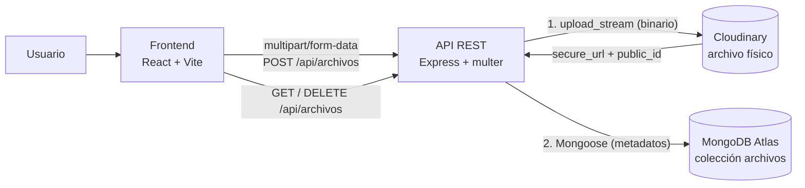

Taller Práctico Colaborativo: Gestor de Activos
Multimedia en la Nube (Cloud Media Vault)

Distribución de Roles y Trabajo en Equipo

Rol 1 - Alejandro
Rol 2 - Santiago
Rol 3 - Jesus
Rol 4 - Yeferson
Rol 5 - Juan Jose

Alejandro: Rol 1 — Arquitecto Cloud y Base de Datos:
○ Configurar el proveedor de almacenamiento en la nube (ej. Cloudinary) y la instancia
de base de datos (Neon.tech o MongoDB Atlas).
○ Diseñar el esquema/modelo de metadatos (id, titulo, url, publicId, tipoArchivo,
tamanoBytes, fechaSubida, subidoPor) y administrar las variables de entorno (.env
y .env.example).

Santiago:  Rol 2 — Desarrollador Backend (Ingesta y Subida Cloud):
○ Implementar el endpoint POST /api/archivos encargado de recibir el formulario
multipart/form-data (multer en Express o formData() en Next.js).
○ Gestionar la transferencia segura del binario hacia el proveedor cloud y validar el
peso máximo y tipos MIME permitidos en el servidor

Jesus: Rol 3 — Desarrollador Backend (Persistencia CRUD y Sincronización):
○ Conectar la respuesta del proveedor cloud con la base de datos para guardar los
metadatos tras confirmar la subida.
○ Implementar los endpoints GET /api/archivos (consulta ordenada y filtros) y
DELETE /api/archivos/:id (eliminación sincronizada tanto en el storage cloud como
en la base de datos).

Yeferson: Rol 4 — Desarrollador Frontend (Formulario de Carga y Validaciones):
○ Construir la interfaz de subida en React/Next.js con soporte de selección de archivo
o Drag & Drop.
○ Empaquetar los datos con FormData, validar peso/formato antes del envío y
gestionar estados visuales de carga (loading spinner / barra de progreso) y alertas de
retroalimentación.

Juan Jose: Rol 5 — Desarrollador Frontend (Galería Multimedia, Filtros y QA):
○ Construir la galería dinámica que consume GET /api/archivos, renderizando
miniaturas de imágenes, reproductor video para videos y previsualización/enlace
para PDFs junto con sus metadatos.
○ Implementar filtros por tipo de archivo y búsqueda por título, además de liderar las
pruebas de integración y limpieza de errores en consola antes de la entrega


---

# Cloud Media Vault: documentación técnica

Los archivos (imágenes, videos y PDF) se guardan en **Cloudinary** y sus metadatos en **MongoDB Atlas**, a través de una API REST en **Express**. El frontend se construye en **React + Vite** (Ruta B: arquitectura desacoplada cliente-servidor).

## Rol 1 — Alejandro — Arquitecto Cloud y Base de Datos

**Integrante:** Alejandro
**Rama:** `Alejandro`

### Responsabilidades

- Configuración del proveedor de almacenamiento en la nube (Cloudinary).
- Configuración de la instancia de base de datos (MongoDB Atlas) y conexión con Mongoose.
- Diseño del modelo de metadatos `Archivo`.
- Administración de las variables de entorno (`.env` y `.env.example`).
- Servidor Express base (CORS, dotenv, manejo de errores y endpoint de salud).

---

## Arquitectura



**Almacenamiento dual desacoplado:**

| Capa | Qué guarda | Servicio |
| --- | --- | --- |
| Archivo físico | El binario (imagen, video o PDF) | Cloudinary |
| Metadatos | La referencia (`url`, `publicId`) y los datos técnicos | MongoDB Atlas |

La base de datos **nunca** guarda el archivo, solo su referencia. Para borrar un archivo se usa el `publicId` en Cloudinary y luego se elimina el documento en Atlas.

### Estructura del backend

```
backend/
├── .env.example                 # Plantilla de variables de entorno
├── package.json
├── scripts/
│   └── verificar-servicios.js   # Comprueba Atlas + Cloudinary y sincroniza índices
└── src/
    ├── app.js                   # App Express: CORS, JSON, /api/salud, 404 y errores
    ├── server.js                # Arranque: conecta a Atlas y levanta el servidor
    ├── config/
    │   ├── env.js               # Carga y valida las variables de entorno
    │   ├── db.js                # Conexión a MongoDB Atlas con Mongoose
    │   └── cloudinary.js        # Configuración del SDK de Cloudinary
    ├── models/
    │   └── Archivo.js           # Modelo de metadatos
    ├── routes/
    │   └── archivos.js          # Endpoints POST, GET y DELETE
    └── services/
        ├── subirArchivo.js      # Subida a Cloudinary
        └── archivos.js          # Guardado, consulta y eliminación
```

---

## Modelo de metadatos `Archivo`

Colección: `archivos`

| Campo | Tipo | Reglas |
| --- | --- | --- |
| `id` | ObjectId | Generado por MongoDB (se expone como `id` en el JSON) |
| `titulo` | String | Obligatorio, sin espacios sobrantes, máx. 150 caracteres |
| `url` | String | Obligatorio, URL pública HTTPS de Cloudinary (`secure_url`) |
| `publicId` | String | Obligatorio y **único**, identificador en Cloudinary |
| `tipoArchivo` | String | `imagen` \| `video` \| `pdf` |
| `mimeType` | String | MIME permitido y coherente con `tipoArchivo` |
| `recursoCloud` | String | `image` \| `video` \| `raw` (resource_type de Cloudinary, necesario para borrar) |
| `tamanoBytes` | Number | Entero, mayor a 0 y máximo `MAX_FILE_SIZE_MB` (10 MB) |
| `fechaSubida` | Date | Automática (`Date.now`), inmutable |
| `subidoPor` | String | Obligatorio, autor del archivo, máx. 80 caracteres |

Además, el JSON incluye el campo virtual `tamanoFormateado` (por ejemplo `2.35 MB`).

**Tipos MIME permitidos**

| Categoría | MIME |
| --- | --- |
| imagen | `image/jpeg`, `image/png`, `image/webp`, `image/gif` |
| video | `video/mp4`, `video/webm`, `video/quicktime` |
| pdf | `application/pdf` |

**Índices** (para consultas ordenadas y óptimas):

| Índice | Uso |
| --- | --- |
| `{ publicId: 1 }` único | Evita registros duplicados y permite buscar por `publicId` |
| `{ fechaSubida: -1 }` | Listado de la galería, más recientes primero |
| `{ tipoArchivo: 1, fechaSubida: -1 }` | Filtro por tipo manteniendo el orden por fecha |
| `{ titulo: 1 }` con collation `es` | Búsqueda por título sin distinguir mayúsculas ni tildes |

**Utilidades exportadas** por `src/models/Archivo.js` para el resto del equipo:

```js
import Archivo, {
  TIPOS_ARCHIVO,        // ['imagen', 'video', 'pdf']
  MIME_PERMITIDOS,      // MIME agrupados por categoría
  TAMANO_MAXIMO_BYTES,  // 10 MB en bytes
  tipoDesdeMime,        // 'image/png' -> 'imagen'
  formatearTamano,      // 2048 -> '2.0 KB'
} from './models/Archivo.js';

import cloudinary, { CARPETA_CLOUDINARY } from './config/cloudinary.js';
```

---

## Variables de entorno

Las credenciales reales van en `backend/.env`, que está en `.gitignore` y **no se sube al repositorio**. El archivo `backend/.env.example` sirve de plantilla.

| Variable | Obligatoria | Descripción | Valor por defecto |
| --- | --- | --- | --- |
| `PORT` | No | Puerto del servidor | `4000` |
| `NODE_ENV` | No | `development` o `production` | `development` |
| `CORS_ORIGIN` | No | Orígenes permitidos, separados por coma | `http://localhost:5173` |
| `MONGODB_URI` | **Sí** | Cadena de conexión de MongoDB Atlas | |
| `MONGODB_DB_NAME` | No | Nombre de la base de datos | `cloud_media_vault` |
| `CLOUDINARY_CLOUD_NAME` | **Sí** | Cloud name de Cloudinary | |
| `CLOUDINARY_API_KEY` | **Sí** | API Key de Cloudinary | |
| `CLOUDINARY_API_SECRET` | **Sí** | API Secret de Cloudinary | |
| `CLOUDINARY_FOLDER` | No | Carpeta donde se guardan los archivos | `cloud-media-vault` |
| `MAX_FILE_SIZE_MB` | No | Tamaño máximo por archivo | `10` |

Si falta alguna variable obligatoria, el servidor no arranca y muestra cuáles faltan.

---

## Configuración de los servicios en la nube

### MongoDB Atlas

1. Crear un cluster gratuito **M0** en [MongoDB Atlas](https://www.mongodb.com/cloud/atlas).
2. En **Database Access**, crear un usuario de base de datos con permiso de lectura y escritura.
3. En **Network Access**, permitir la IP de cada integrante (o `0.0.0.0/0` durante el desarrollo).
4. En **Database > Connect > Drivers**, copiar la cadena de conexión y pegarla en `MONGODB_URI`.

### Cloudinary

1. Crear una cuenta gratuita en [Cloudinary](https://cloudinary.com).
2. En **Settings > API Keys**, copiar `Cloud name`, `API Key` y `API Secret`.
3. Los archivos se guardarán en la carpeta definida en `CLOUDINARY_FOLDER`.

> Las credenciales se comparten con el equipo por un canal privado, nunca en el repositorio.

---

## Instalación y ejecución

**Requisitos:** Node.js 18.18 o superior y npm.

```bash
cd backend
npm install
cp .env.example .env   # en Windows: copy .env.example .env
```

Completar `backend/.env` con las credenciales y luego:

```bash
npm run verificar   # comprueba Atlas y Cloudinary y crea los índices
npm run dev         # servidor con recarga automática
```

| Script | Descripción |
| --- | --- |
| `npm run dev` | Inicia el servidor en modo desarrollo (`node --watch`) |
| `npm start` | Inicia el servidor en modo normal |
| `npm run verificar` | Verifica la conexión con MongoDB Atlas y Cloudinary y sincroniza los índices |

### Endpoint de salud

`GET http://localhost:4000/api/salud`

```json
{
  "estado": "ok",
  "servicios": { "baseDatos": "conectado", "nube": "conectado" },
  "fecha": "2026-11-14T19:23:39.446Z"
}
```

Responde `200` si Atlas y Cloudinary están conectados y `503` si alguno falla.

### Seguridad

- `.env` excluido del repositorio mediante `.gitignore`. Solo se versiona `.env.example`.
- CORS restringido a los orígenes de `CORS_ORIGIN`. Cualquier otro origen recibe `403`.
- Cloudinary configurado con `secure: true`, así todas las URL son HTTPS.
- Validación de variables de entorno al arrancar.
- En producción, los errores internos no exponen detalles al cliente.

## Rol 2 — Santiago — Recepción y subida de archivos

El endpoint `POST /api/archivos` recibe `multipart/form-data` con un archivo en el campo `archivo`, un `titulo` de hasta 150 caracteres y `subidoPor` de hasta 80 caracteres. Ambos textos son obligatorios. El archivo se recibe en memoria y se valida contra los MIME y el límite configurados en el modelo Archivo (10 MB por defecto).

Desde `backend`, ejecutar `npm install` para instalar Multer y actualizar el archivo de bloqueo, completar `.env` con las credenciales compartidas por Alejandro e iniciar con `npm run dev`.

Para probar con Postman, usar POST `http://localhost:4000/api/archivos` y Body → form-data. Configurar `archivo` como File y los otros dos campos como Text. Postman genera el encabezado multipart con su boundary.

Una subida exitosa devuelve HTTP 201 con `titulo`, `subidoPor`, `url`, `publicId`, `tipoArchivo`, `mimeType`, `recursoCloud` y `tamanoBytes`. En esta etapa la respuesta confirma la subida a Cloudinary. El guardado de esos metadatos en Atlas corresponde a la integración del rol 3. La función `subirArchivo` en `backend/src/services/subirArchivo.js` devuelve los metadatos para ese paso.

Los errores devuelven un JSON con el campo `error`: HTTP 400 para formulario, formato o archivo vacío inválidos, 413 para tamaño excedido y 500 para fallos de subida a Cloudinary.

Probar imágenes, videos y PDF permitidos, un formato rechazado, un archivo vacío, uno que exceda el límite, ausencia de archivo, título o autor y un fallo del proveedor. Para repetir pruebas exitosas, recordar que cada solicitud crea un recurso en Cloudinary.

## Rol 3 — Jesús — Persistencia CRUD y sincronización

Archivos: `backend/src/services/archivos.js` (lógica) y `backend/src/routes/archivos.js` (endpoints).

### Guardado tras la subida (`POST /api/archivos`)

Cuando Cloudinary confirma la subida, los metadatos que devuelve `subirArchivo` se guardan en Atlas con el modelo `Archivo`. La respuesta `201` ahora es el documento guardado, con `id`, `fechaSubida` y `tamanoFormateado`.

Si Atlas rechaza el registro (por ejemplo, por validación), el archivo recién subido se borra de Cloudinary para no dejar binarios huérfanos y se responde `400`. Un `publicId` duplicado responde `409` y no borra nada.

### Consulta (`GET /api/archivos`)

| Parámetro | Valores | Por defecto |
| --- | --- | --- |
| `tipo` | `imagen`, `video`, `pdf` o `todos` | todos |
| `q` o `titulo` | Texto contenido en el título (ignora mayúsculas y tildes) | |
| `subidoPor` | Texto contenido en el autor | |
| `orden` | `recientes`, `antiguos`, `titulo`, `tamano` (mayor primero) | `recientes` |
| `pagina` | Entero ≥ 1 | `1` |
| `limite` | Entero entre 1 y 100 | `20` |

Ejemplo: `GET /api/archivos?tipo=imagen&q=logo&orden=recientes`

```json
{
  "total": 1,
  "pagina": 1,
  "limite": 20,
  "totalPaginas": 1,
  "archivos": [
    {
      "id": "6736...",
      "titulo": "Logo",
      "url": "https://res.cloudinary.com/...",
      "publicId": "cloud-media-vault/abc123",
      "tipoArchivo": "imagen",
      "mimeType": "image/png",
      "recursoCloud": "image",
      "tamanoBytes": 24576,
      "tamanoFormateado": "24.0 KB",
      "fechaSubida": "2026-11-16T18:00:00.000Z",
      "subidoPor": "Jesús"
    }
  ]
}
```

Un parámetro inválido (por ejemplo `tipo=audio`) responde `400`. También existe `GET /api/archivos/:id` para consultar un solo archivo.

### Eliminación sincronizada (`DELETE /api/archivos/:id`)

1. Busca el documento en Atlas (`400` si el id no es válido, `404` si no existe).
2. Borra el binario en Cloudinary con `publicId` y `recursoCloud`. Si Cloudinary falla, responde `502` y el registro se conserva para reintentar. Si el archivo ya no existía en Cloudinary, continúa.
3. Borra el documento en Atlas y responde `200`:

```json
{ "mensaje": "Archivo eliminado de Cloudinary y de la base de datos.", "nube": "ok", "archivo": { "id": "6736...", "titulo": "Logo" } }
```

### Pruebas con Postman

1. `POST /api/archivos` con form-data y copiar el `id` de la respuesta.
2. `GET /api/archivos` y comprobar que aparece primero. Probar `?tipo=pdf`, `?q=` sin tildes y `?orden=titulo`.
3. `DELETE /api/archivos/<id>` y comprobar en la Media Library de Cloudinary y en Atlas que desapareció.
4. Repetir el `DELETE`: debe responder `404`. Probar también `DELETE /api/archivos/123` (`400`).

## Rol 4 — Yeferson — Formulario de carga

Archivos: `Frontend/src/main.jsx` (formulario) y `Frontend/src/carga.js` (validación y envío).

El formulario permite escribir el título y el autor, y escoger el archivo con clic o arrastrándolo. Antes de enviarlo revisa que el formato sea permitido y que no pese más de 10 MB. Luego lo envía con `FormData` a `POST /api/archivos`, muestra una barra de progreso mientras sube y al final un mensaje de éxito o de error.

## Rol 5 — Juan José — Galería, filtros y QA

Archivos: `Frontend/src/componentes/` (`GaleriaMultimedia.jsx`, `TarjetaArchivo.jsx`, `VistaPrevia.jsx`, `Filtros.jsx`), `Frontend/src/servicios/api.js`, `Frontend/src/utils/formato.js` y `Frontend/src/galeria.css`.

La galería consume `GET /api/archivos` y muestra cada archivo en una tarjeta con su vista previa: la imagen en miniatura, un reproductor para los videos y un enlace para abrir los PDF. Cada tarjeta muestra el título, quién lo subió, el peso en KB o MB, el tipo y la fecha de subida.

Arriba de la galería están los filtros por tipo (Todos, Imágenes, Videos y PDF) y un buscador por título que no distingue mayúsculas ni tildes. Cada tarjeta tiene un botón para eliminar que llama a `DELETE /api/archivos/:id`. Cuando el backend confirma, la tarjeta desaparece de inmediato sin recargar la página. La galería también se actualiza sola cada vez que se sube un archivo nuevo desde el formulario.

### Pruebas de integración

- Subir una imagen, un video y un PDF, y comprobar que aparecen en la galería, en Cloudinary y en Atlas.
- Intentar subir un archivo de más de 10 MB y uno con formato no permitido: en los dos casos sale un mensaje de error.
- Filtrar por cada tipo y buscar por título con y sin tildes.
- Eliminar un archivo y comprobar que desaparece de la galería, de Cloudinary y de Atlas.
- Apagar el backend y comprobar que la galería muestra un mensaje de error claro.
- Revisar que la consola del navegador (F12) no muestre errores.

## Cómo abrir el proyecto completo

1. **Backend:** en una terminal, entrar a `backend`, ejecutar `npm install`, crear el archivo `.env` a partir de `.env.example` con las credenciales y ejecutar `npm run dev`. Queda en `http://localhost:4000`.
2. **Frontend:** en otra terminal, entrar a `Frontend`, ejecutar `npm install`, copiar `.env.example` como `.env.local` y ejecutar `npm run dev`.
3. Abrir `http://localhost:5173` en el navegador. Arriba aparece el formulario para subir archivos y abajo la galería.
